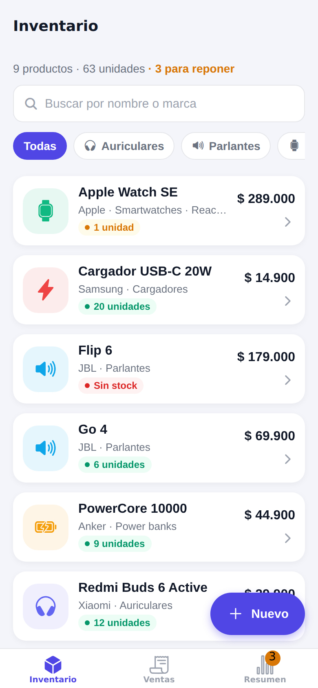
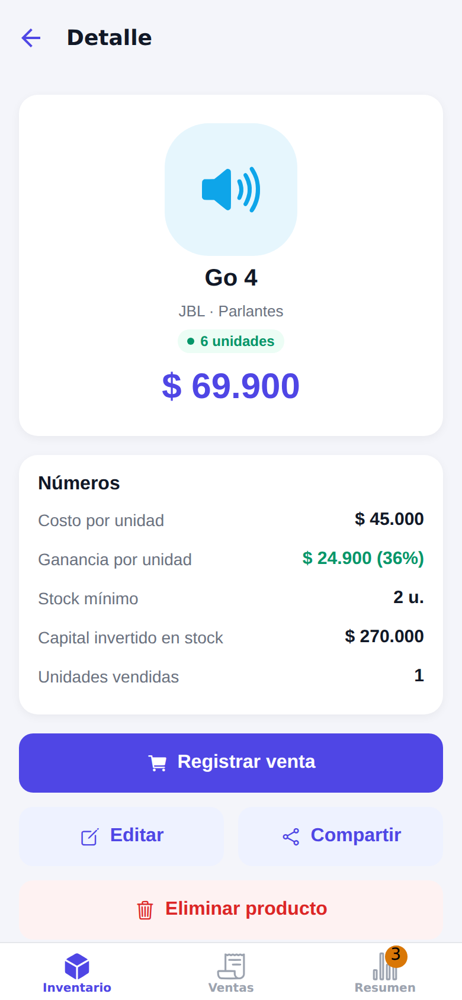
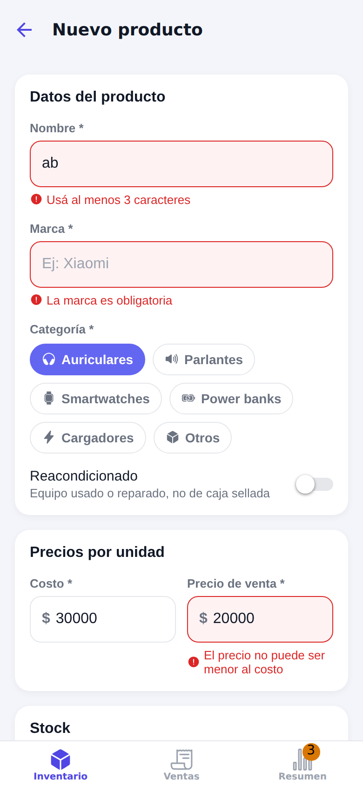
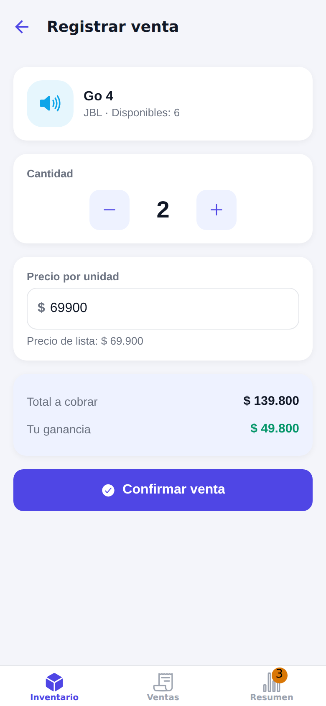
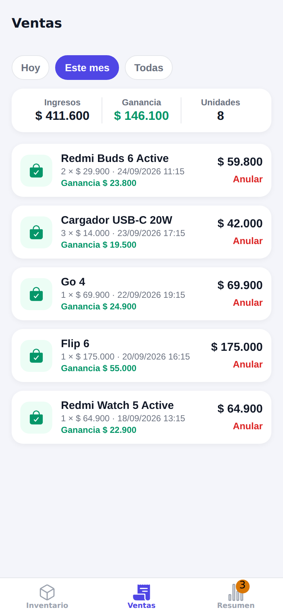
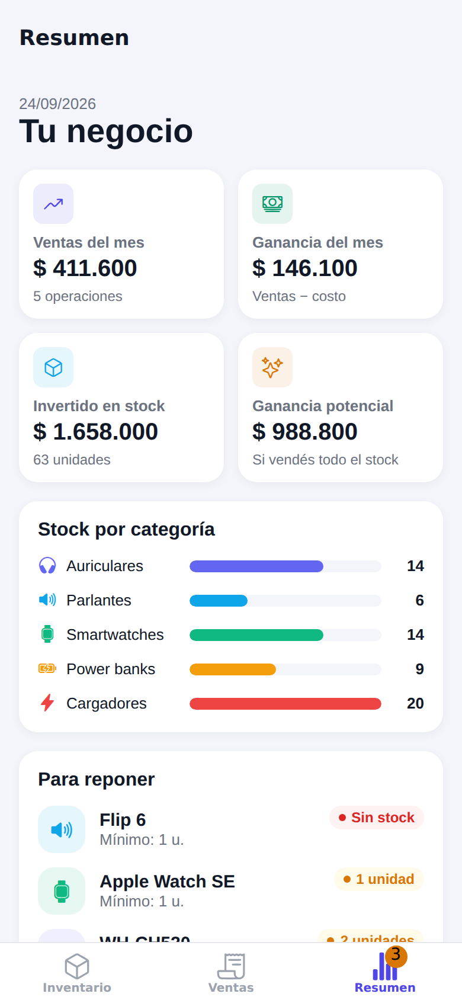

# GadgetStock 📦

App móvil para **gestionar el stock y las ventas de un emprendimiento de gadgets electrónicos** (auriculares, parlantes, smartwatches, power banks, cargadores). Permite cargar productos con foto, registrar ventas que descuentan stock automáticamente, ver qué hay que reponer y seguir los números del negocio.

> Trabajo Práctico Integrador — **Desarrollo de Aplicaciones para Dispositivos Móviles**
> Tecnicatura Superior en Desarrollo de Software · Autor: **Pablo Luna**

| Inventario | Detalle | Formulario con validaciones |
|---|---|---|
|  |  |  |
| **Registrar venta** | **Historial de ventas** | **Resumen del negocio** |
|  |  |  |

---

## ✨ Funcionalidades

- **Inventario (CRUD completo)**: alta, edición y baja de productos, en una `FlatList` con búsqueda por nombre o marca y filtro por categoría.
- **Formulario con validaciones** y feedback visual: el campo se pinta de rojo y muestra el mensaje debajo, el botón queda deshabilitado hasta que todo es válido y se ve una vista previa de la ganancia.
- **Foto del producto** con la **cámara** o la **galería** del teléfono.
- **Compartir** un producto por WhatsApp o cualquier otra app, con un texto listo para mandarle a un cliente.
- **Registrar ventas**: se elige la cantidad (sin superar el stock), se puede aplicar un descuento y el stock se descuenta solo.
- **Historial de ventas** filtrado por período (hoy, este mes o todas), con totales y la opción de **anular** una venta (las unidades vuelven al stock).
- **Resumen**: ventas y ganancia del mes, capital invertido, ganancia potencial, stock por categoría y lista de productos **para reponer**. La pestaña muestra un *badge* con esa cantidad.
- **Persistencia local** con AsyncStorage: los datos no se pierden al cerrar la app.

## 🚀 Cómo ejecutarla

**Requisitos:** Node.js LTS y la app **Expo Go** actualizada en el teléfono (el proyecto usa **Expo SDK 57**, el último estable).

```bash
npm install
npx expo start
```

1. Escaneá el QR con **Expo Go** (Android) o con la **cámara** (iOS). El teléfono y la compu tienen que estar en la misma red Wi-Fi.
2. Si tarda o no conecta, pasá a modo túnel: `npx expo start --tunnel`.
3. Para verla en el navegador, apretá `w` en la terminal.

La primera vez la app carga **datos de ejemplo**. Desde *Resumen → Restaurar datos de ejemplo* se puede volver a ese estado cuando se quiera.

## ✅ Cumplimiento de la consigna

| Requisito | Dónde está |
|---|---|
| Expo + TypeScript, componentes funcionales con hooks | Todo el proyecto (`strict: true` en `tsconfig.json`) |
| **Navegación Stack + Tabs combinadas** (plus) | `src/navigation/AppNavigator.tsx` (Tabs) y `src/navigation/InventarioStack.tsx` (Stack anidado) |
| Parámetros tipados entre pantallas | `src/types/navigation.ts` + `route.params` en cada pantalla |
| **FlatList con alta, edición y baja** | `src/screens/ListaProductosScreen.tsx`, `FormularioProductoScreen.tsx`, `DetalleProductoScreen.tsx` |
| **Formularios con validaciones y feedback visual** | `src/utils/validaciones.ts`, `src/viewmodels/useFormularioProductoViewModel.ts`, `src/components/CampoTexto.tsx` |
| Estilos con Flexbox, responsive | `src/styles/` + `StyleSheet.create` en cada componente (grillas con `flexWrap`, columnas con `flex: 1`) |
| **Interacción nativa** | Cámara y galería (`src/services/camara.ts`), menú Compartir (`src/services/compartir.ts`), Alert nativo (`src/utils/dialogos.ts`) |
| Estados y condicionales claros | Listas vacías, stock sin/bajo/ok, botones deshabilitados, producto no encontrado |
| Persistencia local (plus) | `src/services/almacenamiento.ts` (AsyncStorage) |

## 🧱 Arquitectura: MVVM

La app separa **qué se muestra** (Vista) de **cómo se calcula** (ViewModel) y de **los datos** (Modelo):

```
┌──────────────────────────────────────────────────────────────┐
│ VISTA   src/screens/ + src/components/                       │
│         Sólo dibuja. Recibe datos y funciones del ViewModel. │
└───────────────┬──────────────────────────────────────────────┘
                │ usa el hook
┌───────────────▼──────────────────────────────────────────────┐
│ VIEWMODEL   src/viewmodels/use…ViewModel.ts                  │
│         Custom hooks: estado de la pantalla (búsqueda,       │
│         formulario), estado derivado (errores, totales) y    │
│         acciones (guardar, confirmar venta).                 │
└───────────────┬──────────────────────────────────────────────┘
                │ lee / modifica
┌───────────────▼──────────────────────────────────────────────┐
│ MODELO   src/types/  (formas de los datos)                   │
│          src/context/InventarioContext.tsx (fuente de verdad)│
│          src/utils/  (reglas puras: cálculos, validaciones)  │
│          src/services/ (AsyncStorage, cámara, compartir)     │
└──────────────────────────────────────────────────────────────┘
```

**Ejemplo, registrar una venta:**
1. En `RegistrarVentaScreen` (Vista) el usuario toca "Confirmar venta".
2. La Vista llama a `vm.confirmar()` en `useRegistrarVentaViewModel` (ViewModel). El ViewModel ya validó cantidad y precio con `validarVenta`.
3. El ViewModel llama a `registrarVenta()` del `InventarioContext` (Modelo). Ahí se crea la venta y se descuenta el stock de forma inmutable (`map`).
4. El Context guarda todo en AsyncStorage, y **todas** las pantallas que usan esos datos (lista, detalle, resumen, badge) se actualizan solas.

**Por qué MVVM acá:** las pantallas quedan cortas y fáciles de leer, la lógica se puede cambiar sin tocar el diseño y las reglas de negocio (`utils/`) son funciones puras que se pueden probar por separado.

## 📁 Estructura de carpetas

```
App.tsx                         ← punto de entrada: providers + navegación
src/
├── navigation/
│   ├── AppNavigator.tsx        ← NavigationContainer + Tabs (Inventario, Ventas, Resumen)
│   └── InventarioStack.tsx     ← Stack: Lista → Detalle → Formulario / Registrar venta
├── screens/                    ← VISTAS (una pantalla por archivo)
│   ├── ListaProductosScreen.tsx
│   ├── DetalleProductoScreen.tsx
│   ├── FormularioProductoScreen.tsx   (alta y edición)
│   ├── RegistrarVentaScreen.tsx
│   ├── VentasScreen.tsx
│   └── ResumenScreen.tsx
├── viewmodels/                 ← VIEWMODELS (custom hooks, uno por pantalla)
├── components/                 ← componentes visuales reutilizables
│   └── BotonPrimario, CampoTexto, ChipFiltro, TarjetaProducto, TarjetaVenta, …
├── context/
│   └── InventarioContext.tsx   ← estado global (Context API) + persistencia
├── services/                   ← acceso a cosas "de afuera": AsyncStorage, cámara, compartir
├── types/                      ← models.ts, formularios.ts, navigation.ts
├── utils/                      ← funciones puras: formato, cálculos, validaciones, categorías
├── data/
│   └── datosIniciales.ts       ← datos de ejemplo
└── styles/                     ← colors.ts, typography.ts, global.ts
docs/capturas/                  ← imágenes del README
```

## 📦 Dependencias

| Librería | Para qué se usa |
|---|---|
| `expo`, `react-native`, `react` | Base del proyecto (Expo SDK 57). |
| `@react-navigation/native`, `native-stack`, `bottom-tabs` | Navegación Stack + Tabs, como se vio en las clases 4 a 6. |
| `react-native-screens`, `react-native-safe-area-context` | Requeridas por React Navigation: pantallas nativas y respeto del notch y de la barra de gestos. |
| `@expo/vector-icons` | Íconos (Ionicons) incluidos en Expo Go, tipados con `keyof typeof Ionicons.glyphMap`. |
| `@react-native-async-storage/async-storage` | Guardar productos y ventas en el teléfono (persistencia local). |
| `expo-image-picker` | Sacar una foto con la cámara o elegirla de la galería (interacción nativa). |
| `expo-status-bar` | Color de la barra de estado. |
| `react-dom`, `react-native-web`, `@expo/metro-runtime` | Sólo para poder abrir la app en el navegador con la tecla `w`. |

El menú **Compartir** usa `Share`, que ya viene con React Native. No hace falta ninguna librería extra.

## 🧠 Decisiones técnicas

- **React Navigation (y no Expo Router):** es lo que se trabajó en la cursada. Además, declarar las rutas a mano con `RootTabParamList` y `InventarioStackParamList` deja explícito qué parámetros recibe cada pantalla.
- **Entre pantallas sólo viaja el `id`:** los datos se leen del Context. Así el detalle nunca muestra una copia vieja del producto, y no se pasan funciones por parámetro, algo que React Navigation desaconseja porque no son serializables.
- **Context API en lugar de Redux:** para una app de este tamaño alcanza, no suma dependencias y es fácil de explicar.
- **Los errores del formulario son estado derivado:** se calculan en cada render con `validarProducto(form)` y no se guardan en otro `useState`. El estado *"tocados"* sólo sirve para no mostrar errores antes de que el usuario escriba.
- **Las ventas guardan una "foto" del producto** (nombre, costo y precio al momento de vender). Si después se edita o se borra el producto, el historial y la ganancia no cambian.
- **Montos en pesos enteros** y un formateador propio (`formatoPrecio`), sin depender de `Intl`, para que se vea igual en cualquier teléfono.

## ⚠️ Limitaciones conocidas

- Los datos se guardan **sólo en el teléfono**: no hay usuarios, sincronización ni backend.
- La foto se guarda como la ruta del archivo en el teléfono. Si se desinstala Expo Go o se borra la caché, la imagen se pierde y aparece el ícono de la categoría.
- Las ventas se pueden **anular**, pero no editar.
- No hay tests automáticos. Las reglas de negocio están aisladas en funciones puras (`src/utils/`) para poder agregarlos después.
- En la versión web (tecla `w`), los carteles usan `window.confirm` porque `Alert.alert` no funciona en el navegador.

## 🤖 Declaración de uso de IA

> ✏️ *Ajustá este texto para que refleje exactamente cómo trabajaste.*

Para este trabajo usé **Claude (Anthropic)** como asistente de programación: me ayudó a proponer la arquitectura, a generar el código base, los componentes y esta documentación, a partir del material de las clases 1 a 12 de la materia. Revisé, probé y ajusté el código, y puedo explicar cada parte: navegación, formularios y validaciones, estado global con Context, persistencia y el uso de la cámara.
